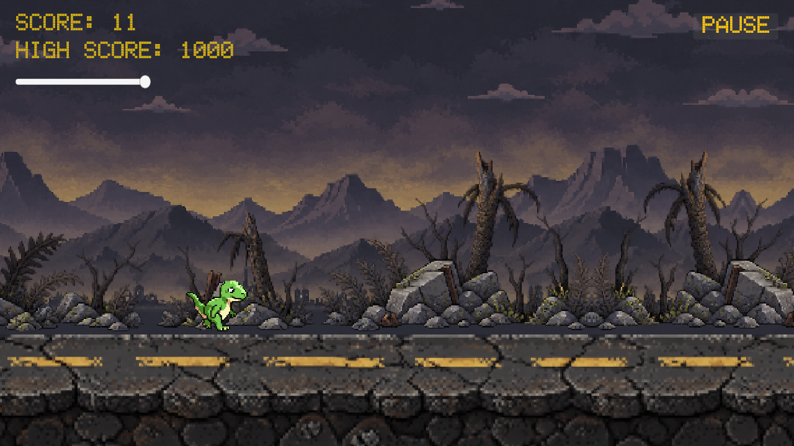
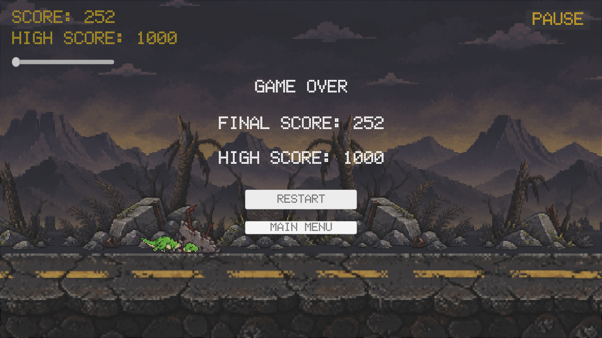
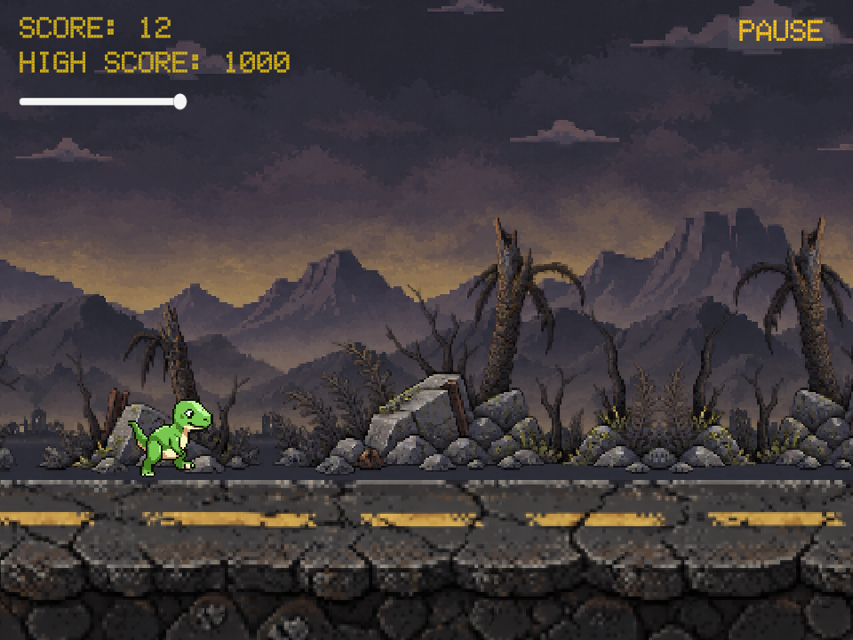
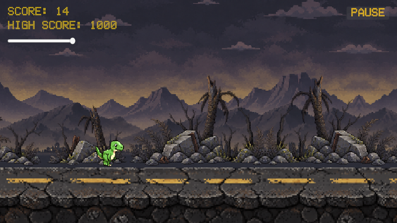
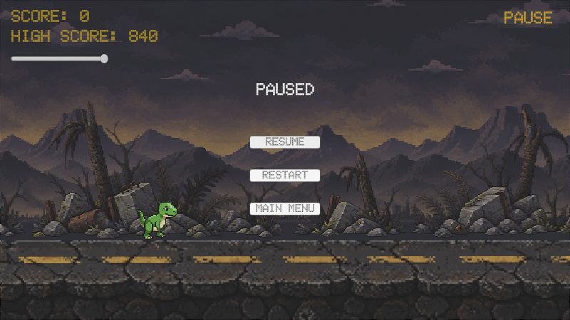

# Chrome Dino Runner — Homework 1

**Alireza Pooyan · Student ID 400414039 · 27 October 2026**

**Release target:** Windows x86_64, Mono. **Unity:** 6000.6.3f1 (45d8eee7de74). Startup scene: `Assets/Scenes/Game.unity`. Development Build, script debugging, and profiler connection are disabled. The existing Editor, packages, artwork, physics, settings, and decorative obstacle overhangs were preserved. Company/product identifiers remain `DefaultCompany` / `DinoRunner`.

| Control | Action |
| --- | --- |
| Space | One jump per grounded press; release before jumping again |
| Left or Right Shift | Short dash, followed by cooldown |
| Escape | Pause / resume |
| Arrows and Enter; mouse | Navigate / activate menu buttons |
| Main Menu → Quit | Close the standalone game |

## Actual implementation

`GameSession` initializes the scene and owns MainMenu, Playing, Paused, and GameOver. `RunnerInputReader` queues New Input System actions; the session gives pause priority. `PlayerController` handles jump, dash, and physics, while `PlayerHealth` owns the three lives. `RunnerSettings` holds the existing gameplay values.

`WorldScrollController` integrates one shared movement distance. `SpawnController` uses it to move hazards and uranium, and three `ParallaxLayer` instances scroll the far scenery, near scenery, and asphalt at factors 0.2, 0.5, and 1.0. Prefabs are instantiated/despawned; there is no object pool.

`ScoreTracker` combines distance and item points. `HudController` displays score, record, and health. `MenuController` switches separate panels. `PlayerAnimationController` drives the Animator; `PlayerHitFeedback` supplies the temporary hit/dash tint. Restart resets the current scene without reloading it.

<!-- pagebreak -->

# Requirement coverage

| Requirement | Implemented behavior / final evidence |
| --- | --- |
| Parallax scrolling | Two scenery factors plus full-speed asphalt use shared movement. Existing wrap/coverage evidence retained. |
| New Input System only | Active Input Handling = New; gameplay action references and exactly one InputSystemUIInputModule. No legacy input calls in runtime scripts. |
| Three lives and health bar | PlayerHealth starts at 3. Actual-scene simulation observed the bar at 3, 2, 1, and 0. |
| Space jump; Shift dash | Input routing/physics suites pass. Actual scene confirms jump/landing, dash tint, duration, and speed restoration through its command queue. |
| Ground/aerial hazards; Game Over | Original spawner/physics produced ground damage, aerial damage during a jump, and a fatal third hit. |
| Interactable inheritance | GroundObstacle/AerialObstacle → Obstacle → Interactable. CoinCollectible → Interactable. Shared encounter guard prevents duplicate effects. |
| Animator and hit feedback | Run, Jump, Hit, Death clips/states and transitions inspected; actual scene reached all four. Accepted hits visibly flash red. |
| Separate menus and live scores | Main, pause, and Game Over panels are distinct. HUD displays current score, high score, and health. Game Over heading corrected. |
| PlayerPrefs persistence | PlayerPrefsHighScoreStore uses ChromeDino.HighScore.v1. Save/load/dirty-record tests pass; full Windows close/relaunch is pending. |
| Uranium and coin patterns | Each uranium item awards exactly 50 once. Single, three-item row, shallow arc, and repeated-jump patterns retain passing tests. |
| One-time difficulty increase | At 499 points speed is 6; at 500 it becomes 7.5. It remains 7.5 at 1000. Dash is 12/15; restart restores the base stage. |

<!-- pagebreak -->

# Verification and resolution review

**Automated Editor checks:** 32/32 Edit Mode tests and 39/39 Play Mode tests passed with no failures or skips. A further 24/24 production-scene simulation checks passed. The scene probe used original spawning, fixed updates, physics, and player commands; it did not call damage or pickup interaction methods directly. Keyboard action routing was tested separately by the Play Mode suites. A frame-change wait confirmed live Editor advancement.

**Visual review:** Codex inspected actual Game view captures at 1280×720, 960×720, and 800×450, including the overlay HUD. Scenery/asphalt coverage and score, health, and menu readability were checked. This is automated execution plus visual inspection, not a claim of human playtesting. Earlier 28-check asphalt evidence remains applicable; no scrolling code or assets changed during submission preparation.

<!-- pagebreak -->

# Build, limitations, and review

**Build result:** Windows x86_64 Mono release succeeded through the official Unity CLI on an isolated copy of the staged project, using the same Editor and packages: 205 generated files, 112.3 MB, zero errors. One bundled TMP shader uses a deprecated pragma; it was left unchanged. The live attempt was cancelled after prolonged import; an isolated retry succeeded using compiled caches. The complete generated Build directory is included. Repository.txt identifies the repository and final commit. Old archives/checkpoints remain locally but are untracked.

**Standalone limitation:** This preparation machine runs Linux and has no Windows runtime/Wine. Neither the original nor extracted Windows executable could be launched here. Windows main menu/input, jump/dash/pause, naturally encountered hazards and uranium, 500-point difficulty, death/restart/Quit, scrolling, and cross-launch high-score persistence remain target-machine acceptance checks. Automated Editor success does not prove Windows player success.

**Before uploading on Windows:** Extract the entire ZIP, keep all files in Build together, and run `Build/DinoRunner.exe`. Use keyboard and mouse menus; jump/dash/pause, collect uranium, collide with both hazard types, reach 500 points, then die/restart. Check background/asphalt motion and UI at 1280×720, 960×720, and 800×450. Set a new record, return to Main Menu, Quit fully, relaunch, and confirm the record. Confirm the repository URL opens/clones without a privileged account. Review this report and the code before submission.

Decorative rubble/rebar and drone rotors intentionally extend beyond the unchanged hitboxes; assess subjective collision fairness. Mirrored scenery repeats are intentional. No long human endurance playtest or Windows compatibility result is claimed. The assignment PDF gives a deadline of 26 Mehr 1405; no extension is assumed.

## Sources and assistance

The supplied `HM1.pdf` and `.gitignore` were read from `HM1 (2).zip`. The earlier implementation brief and project documentation also informed the work. **OpenAI Codex/ChatGPT** assisted implementation, checking, report drafting, and packaging: [openai.com/codex](https://openai.com/codex/). **Sprite AI** supplied existing generated dinosaur artwork/animation: [sprite-ai.art](https://www.sprite-ai.art/). Student-supplied scenery/prop artwork was imported and processed locally; its original provenance is not documented here and should be reviewed by the student. No human collaborator is asserted. Zero Sprite AI tokens were spent during this submission preparation.

Technical sources actually recorded in the project include [Unity 6.6 Rigidbody2D.linearVelocity](https://docs.unity3d.com/6000.6/Documentation/ScriptReference/Rigidbody2D-linearVelocity.html), [Collider2D.Cast](https://docs.unity3d.com/6000.6/Documentation/ScriptReference/Collider2D.Cast.html), installed Input System 1.20.1 source/test helpers, uGUI/TMP, and Test Framework 1.8.0. Full pinned versions remain in Packages. The repository also retains Unity's imported TMP/OFL and included asset notices.
